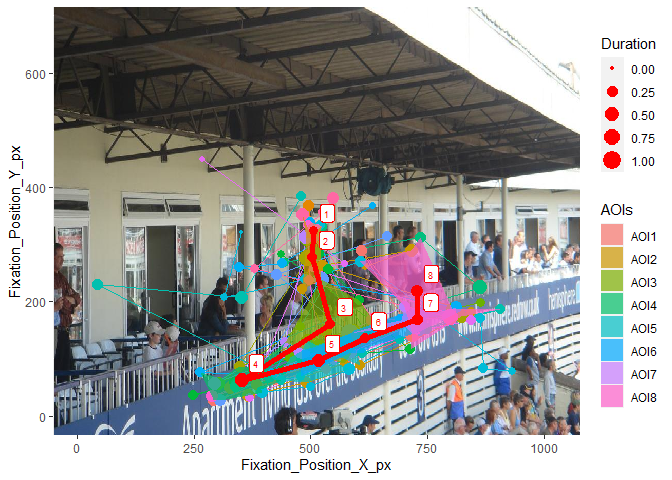

<!-- README.md is generated from README.Rmd. Please edit that file -->

# scanpathAggr

<!-- badges: start -->
<!-- badges: end -->

The goal of scanpathAggr is to find an aggregated view strategy in a
sample through a representative scanpath.

## Installation

Download the Windows ZIP or the R source tarball from the
[latest GitHub release](https://github.com/HeHuangDortmund/scanpathAggr/releases/latest).

Install the CRAN dependencies if needed:

``` r
install.packages(
  c("dbscan", "concaveman", "data.table", "sf", "sp", "ggplot2", "imager"),
  repos = "https://cloud.r-project.org"
)
```

On Windows with R 4.6, install the ZIP from your download folder:

``` r
install.packages(file.choose(), repos = NULL, type = "win.binary")
```

On macOS or Linux, select the `.tar.gz` archive instead:

``` r
install.packages(file.choose(), repos = NULL, type = "source")
```

## Example

This is a basic example which shows how to find a representative scanpath in a sample:

``` r
library(scanpathAggr)

data(scanpath_MIT1003_i1182314083)
reprensentScanpath = scanpathAggr(scanpath_MIT1003_i1182314083, 3)
stimuluspath = system.file('stimulus/i1182314083.jpeg', package = "scanpathAggr")
scanpathVisualisation(scanpath_MIT1003_i1182314083, reprensentScanpath, stimuluspath)
```



